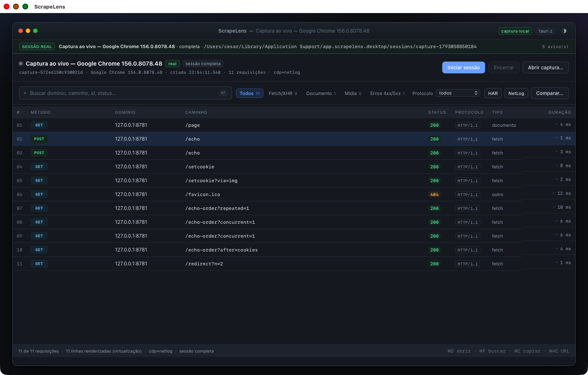
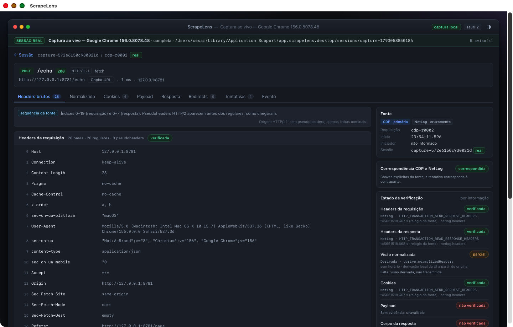
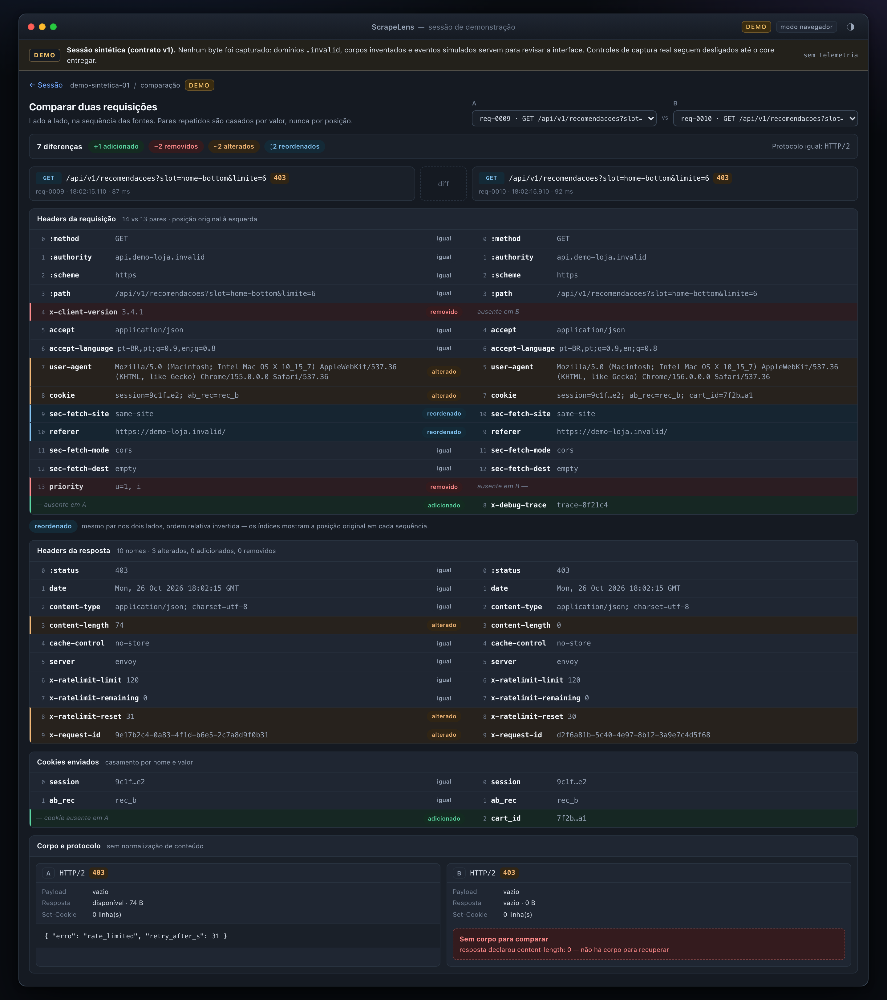
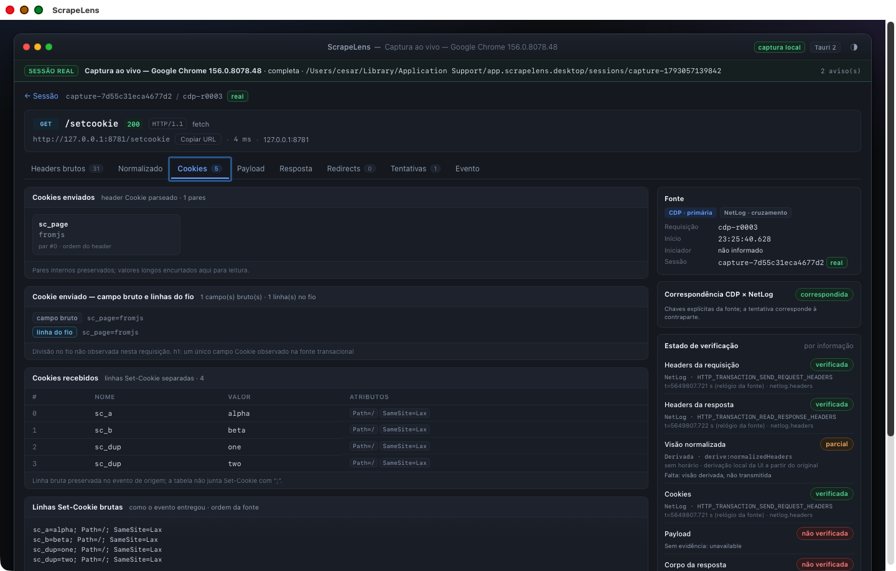
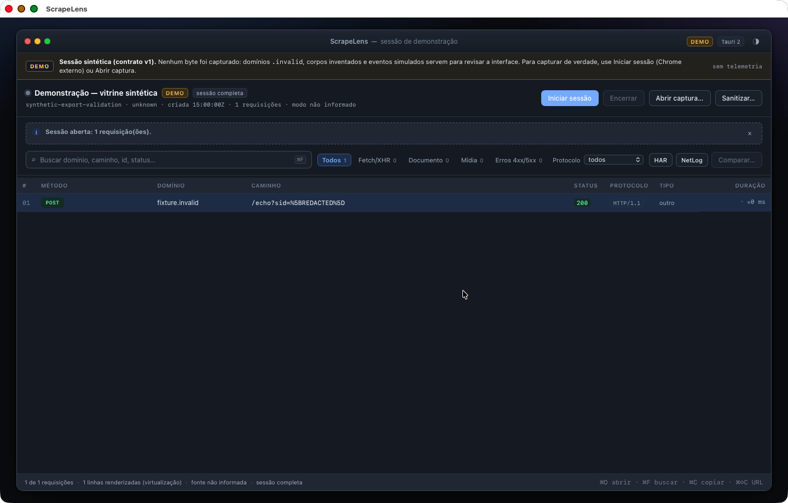

<div align="center">

# 🔍 ScrapeLens

**Inspetor local de sessões HTTP de alta fidelidade e servidor MCP para engenharia reversa de fluxos web e scraping.**

[](https://github.com/cesarhmatias/ScrapeLens/releases)
[](LICENSE)
[%20%7C%20Linux%20(amd64%2C%20arm64)-lightgrey?style=flat-square)](src-tauri/EMPACOTAMENTO.md)
[](core/Cargo.toml)
[](src-tauri/tauri.conf.json)
[](docs/16-mcp-contrato.md)

[Instalação](#-instalação-e-pacotes) •
[Destaques](#-principais-recursos) •
[App Desktop](#-uso-do-app-desktop) •
[Servidor MCP](#-servidor-mcp-para-agentes-llm) •
[Arquitetura](#-arquitetura-do-repositório) •
[Desenvolvimento](#-desenvolvimento-e-build) •
[Licença](#-licença)

</div>

---

O **ScrapeLens** captura tráfego de navegadores Chromium (Chrome, Brave, Arc, Edge, CloakBrowser) combinando **Chrome DevTools Protocol (CDP)** por pipe e **NetLog** em fluxo contínuo, ou importa arquivos **HAR** e **NetLog** existentes. Diferente de ferramentas convencionais que normalizam cabeçalhos em dicionários, o ScrapeLens preserva a **sequência exata reportada pela fonte**, cabeçalhos duplicados, capitalização original, pseudo-headers HTTP/2 e HTTP/3 (`:method`, `:path`, `:authority`, `:scheme`), cadeias de redirecionamento, tentativas de rede e **proveniência explícita por campo**.

Construído em **Tauri 2 + React/TypeScript + Rust**, roda **100% localmente**, sem sidecars externos, sem nuvem e **sem telemetria**.



---

## ✨ Principais Recursos

| Recurso | Descrição |
|---|---|
| **Fidelidade de Protocolo & Proveniência** | Preserva arrays ordenados de headers com duplicatas e caixa original. Distingue visualmente entre ordem **verificada no fio** (`NetLog` / `headersText` HTTP/1.1) e ordem **não verificada** (objetos CDP/HAR). |
| **Captura Multi-Alvo por Pipe (`fd 3`/`fd 4`)** | Anexa automaticamente a páginas, popups, `iframes` cross-origin (`OOPIF`), Service Workers e Shared Workers usando pipe nativo do DevTools (`--remote-debugging-pipe`), sem abrir portas TCP locais por padrão. |
| **Importação de Cookies do Navegador** | Opcionalmente importa e decifra em memória cookies de uma sessão existente (Chrome, Brave, Arc, Edge, Chromium, Firefox ou Safari no macOS/Linux) antes da primeira navegação para já iniciar autenticado. |
| **Rastreamento de Origem e Priming** | Rastreia de onde surgiu cada cookie, token CSRF, ViewState ou parâmetro dinâmico ao longo da sessão e gera scripts Python (`requests.Session`) de **priming** de múltiplas etapas sem segredos embutidos. |
| **Adaptadores de Protocolo (Natural for Ajax)** | Decodifica, compara e recodifica protocolos legados baseados em XML/formulários dinâmicos (`adapters/natural-ajax` — ex.: `natparamext`, `F-STAMP`, `SUBPAGE`), com validação de execução integrada. |
| **Exportação Sanitizada ou Completa** | Gere comandos `cURL` e scripts Python por requisição, ou exporte a sessão inteira: **sanitizada por padrão** (redigindo cookies, tokens, senhas e omitindo eventos brutos) ou **captura completa com dados sensíveis** mediante confirmação explícita (checkbox na UI ou `include_sensitive: true` no MCP). |
| **Servidor MCP Nativo (`scrapelens-mcp`)** | Expõe **15 ferramentas MCP** sobre `stdio` para que agentes de IA inspecionem sessões, busquem corpos, rastreiem tokens, comparem requisições, exportem capturas e dirijam o navegador com confirmação humana (elicitação MCP). |
| **Escalabilidade para Grandes Sessões** | Parser NetLog em streaming (`O(requisições HTTP)`), armazenamento de anexos deduplicado com escrita segura (`0700`/`0600`, `O_NOFOLLOW`), paginação no backend e lista virtualizada no front-end. |

<details>
<summary><b>📸 Ver mais capturas de tela</b></summary>
<br>

| Detalhe Verificado (Headers & Proveniência) | Comparação Lado a Lado (Diff) |
|---|---|
|  |  |

| Inspeção de Cookies (`Cookie` vs `Set-Cookie`) | Exportação Sanitizada |
|---|---|
|  |  |

</details>

---

## 📦 Instalação e Pacotes

Baixe os binários pré-compilados na aba [**Releases**](https://github.com/cesarhmatias/ScrapeLens/releases):

- **macOS (Apple Silicon `arm64`)**: `ScrapeLens-0.1.0-macos-arm64.zip` (`ScrapeLens.app`)
- **Linux (`x86_64` / `amd64`)**: `ScrapeLens_0.1.0_amd64.deb` e `ScrapeLens_0.1.0_amd64.AppImage`
- **Linux (`aarch64` / `arm64`)**: `ScrapeLens_0.1.0_arm64.deb` e `ScrapeLens_0.1.0_aarch64.AppImage`

### Executando no macOS

Descompacte o `ScrapeLens.app` (ou use o bundle compilado em `src-tauri/target/release/bundle/macos/ScrapeLens.app`) e mova para `/Applications` ou abra via terminal:

```sh
open src-tauri/target/release/bundle/macos/ScrapeLens.app
```

> **Nota sobre assinatura:** O pacote utiliza assinatura local (`ScrapeLens Local Signing` / ad-hoc), sem notarização da Apple. Caso o Gatekeeper bloqueie a primeira abertura, execute `xattr -dr com.apple.quarantine /Applications/ScrapeLens.app` ou abra via clique secundário → **Abrir**. Detalhes e hashes `SHA-256` em [`src-tauri/EMPACOTAMENTO.md`](src-tauri/EMPACOTAMENTO.md).

---

## 🖥️ Uso do App Desktop

1. **Capturar sessão ao vivo**:
   - Informe opcionalmente a **URL inicial** e, se desejar entrar já logado, selecione o navegador de origem no menu **Cookies** (ou mantenha `Sessão limpa`).
   - Clique em **Iniciar sessão**. O ScrapeLens abrirá uma instância isolada do Chrome com perfil temporário (`0700`).
   - Execute o fluxo desejado no navegador e clique em **Encerrar** no ScrapeLens.
2. **Abrir ou Importar** (`⌘O`):
   - Abra uma pasta de sessão nativa (`session.json`) ou importe arquivos **HAR** e **NetLog** pelos botões dedicados na barra superior.
3. **Inspecionar e Buscar**:
   - Filtre por texto, método, status, protocolo, tipo MIME ou alvo (`target`).
   - Use a **Busca em corpos** para localizar chaves JSON, parâmetros de formulário, regex ou valores em headers/cookies/payloads.
   - Inspecione **Headers**, **Cookies**, **Payload**, **Resposta**, **Redirects**, **Tentativas**, **Proveniência** e **Linha do tempo**.
4. **Comparar e Rastrear**:
   - Clique em **Comparar…** para diff estrutural entre duas requisições da mesma sessão ou entre sessões diferentes.
5. **Exportar e Sanitizar**:
   - Em qualquer requisição, clique em **Exportar…** para gerar `cURL`, script `Python (requests)` ou script de **Priming** (com suporte opcional ao wrapper `Natural for Ajax`), além de **Validar execução…** contra o alvo.
   - Na barra superior, clique em **Exportar / Sanitizar…** para gravar uma cópia da sessão em disco (`0700`/`0600`):
     - **Desmarcado (padrão):** gera `<sessao>-sanitized` com redação conservadora de segredos e remoção de eventos brutos.
     - **Marcado (`Incluir dados sensíveis`):** gera `<sessao>-full` preservando integralmente cookies, tokens, corpos e os arquivos brutos (`cdp-events.jsonl`, `netlog.json`, `cdp-bodies.jsonl`).

### Atalhos de Teclado

| Atalho | Ação |
|---|---|
| `⌘O` / `Ctrl+O` | Abrir pasta de sessão |
| `⌘F` / `Ctrl+F` | Focar busca de requisições |
| `⌘⇧C` / `Ctrl+Shift+C` | Copiar URL da requisição selecionada |
| `↑` / `↓` | Navegar pela lista de requisições |
| `Esc` | Fechar modal / limpar seleção |

---

## 🤖 Servidor MCP para Agentes LLM

O binário `scrapelens-mcp` implementa o **Model Context Protocol (MCP)** sobre `stdio`, permitindo que assistentes de IA (Claude Desktop, Cursor, OpenCode, etc.) analisem capturas e conduzam sessões de engenharia reversa com proteção contra vazamento acidental de segredos.

### Compilando e configurando o MCP

```sh
cargo build --manifest-path mcp/Cargo.toml --release
```

Exemplo de configuração (`mcpServers`):

```json
{
  "mcpServers": {
    "scrapelens": {
      "command": "/caminho/para/ScrapeLens/mcp/target/release/scrapelens-mcp",
      "args": [
        "--sessions-dir",
        "/Users/voce/Library/Application Support/app.scrapelens.desktop/sessions"
      ]
    }
  }
}
```

### As 15 Ferramentas do `scrapelens-mcp`

| Categoria | Ferramenta | Descrição |
|---|---|---|
| **Sessões** | `list_sessions` | Lista sessões disponíveis no diretório de trabalho e diretórios extras (somente leitura). |
| | `import_session` | Importa um arquivo `.har`, `.json` (NetLog) ou diretório de captura para o cofre de sessões. |
| | `export_session` | Exporta uma sessão para disco: sanitizada por padrão (`include_sensitive: false`) ou **completa com dados sensíveis e artefatos brutos** (`include_sensitive: true`). |
| | `site_profile` | Resume hosts, protocolos (`h1`/`h2`/`h3`), status, cookies, autenticação e possíveis desafios/CAPTCHAs da sessão. |
| **Inspeção & Busca** | `list_requests` | Lista e filtra requisições por host, método, status, texto, domínio ou paginação (`cursor`). |
| | `get_request` | Retorna detalhes completos da requisição/resposta, headers na ordem original, cookies e proveniência. |
| | `get_body` | Lê o corpo capturado (inline para textos pequenos ou gravado em `--out-dir` para payloads grandes/binários). |
| | `search_bodies` | Busca textual/estrutural em URLs, headers, cookies e corpos capturados. |
| **Análise & Diff** | `trace_value` | Rastreia onde um cookie, header ou valor dinâmico apareceu pela primeira vez (`firstSetter`) e onde foi consumido. |
| | `diff_requests` | Compara duas requisições da mesma sessão (URL, query, headers, cookies e campos de corpo). |
| | `diff_sessions` | Emparelha e compara requisições equivalentes entre duas sessões distintas. |
| **Captura ao Vivo** | `start_capture` | Inicia captura controlada em navegador Chromium/CloakBrowser com escopo de hosts e confirmação do usuário via elicitação MCP (suporta `cookie_source` para importar cookies). |
| | `navigate` | Navega a aba monitorada para uma nova URL dentro dos hosts autorizados. |
| | `capture_status` | Consulta contagens de eventos, requisições e avisos da captura ativa. |
| | `stop_capture` | Encerra a captura, persiste a sessão correlacionada (`CDP + NetLog`) e devolve o `sessionId`. |

> Consulte o contrato completo em [`docs/16-mcp-contrato.md`](docs/16-mcp-contrato.md) e o guia de navegador/cookies em [`docs/16b-mcp-navegador.md`](docs/16b-mcp-navegador.md).

---

## 🏗️ Arquitetura do Repositório

```text
ScrapeLens/
├── app/                  # Interface desktop em React 18 + TypeScript + Vite
├── src-tauri/            # Shell nativo Tauri 2 (macOS & Linux), comandos IPC, preferências e exportação
├── core/                 # Modelo de domínio, parsers (HAR, NetLog streaming, CDP), correlação, diff, priming, sanitização e CLI
├── capture/              # Motor de captura ao vivo (CDP via pipe fd 3/4, NetLog, multi-target, importação de cookies)
├── mcp/                  # Servidor Model Context Protocol (15 ferramentas stdio + scrub de segredos + elicitação)
├── recon/                # Diagnóstico de superfície de sites, detecção de WAF/CAPTCHA e perfilamento
├── adapters/
│   └── natural-ajax/     # Parser, diff e encoder para o protocolo Natural for Ajax
├── testserver/           # Servidores locais de teste (HTTP/1.1, HTTP/2, HTTP/3 e simulador DETRAN)
├── fixtures/             # Fixtures sintéticas e casos de aceite
├── tests/                # Bateria automatizada de aceite e integração ponta a ponta
└── docs/                 # Especificações de arquitetura, matriz de fidelidade, contratos e relatórios
```

---

## 🛠️ Desenvolvimento e Build

### Pré-requisitos

- **Rust** `1.88+` (`cargo`, `clippy`)
- **Node.js** `20+` e `npm`
- **Xcode Command Line Tools** (no macOS) ou dependências WebKitGTK/Tauri (no Linux — veja [`docs/21-linux.md`](docs/21-linux.md))

### Comandos principais (a partir da raiz)

```sh
# 1. Instalar dependências e validar front-end
npm --prefix app ci
npm --prefix app run typecheck
npm --prefix app test
npm --prefix app run build

# 2. Executar suítes de testes Rust
cargo test --manifest-path core/Cargo.toml
cargo test --manifest-path capture/Cargo.toml
cargo test --manifest-path mcp/Cargo.toml
cargo test --manifest-path src-tauri/Cargo.toml
cargo test --manifest-path adapters/natural-ajax/Cargo.toml

# 3. Executar em modo desenvolvimento
./app/node_modules/.bin/tauri dev

# 4. Gerar bundle macOS (.app)
./app/node_modules/.bin/tauri build --bundles app
```

Para usar o CLI de desenvolvimento do `core` diretamente:

```sh
cargo build --manifest-path core/Cargo.toml --release
./core/target/release/scrapelens-core inspect /caminho/da/sessao
./core/target/release/scrapelens-core export-curl /caminho/da/sessao cdp-r0001
./core/target/release/scrapelens-core export-python /caminho/da/sessao cdp-r0001
./core/target/release/scrapelens-core sanitize /caminho/da/sessao /caminho/saida-sanitizada
```

Para diretrizes de contribuição, consulte [`CONTRIBUTING.md`](CONTRIBUTING.md).

---

## 📄 Licença

Distribuído sob a licença **MIT**. Veja o arquivo [`LICENSE`](LICENSE) para o texto completo.

Copyright © 2026 Cesar Matias.
