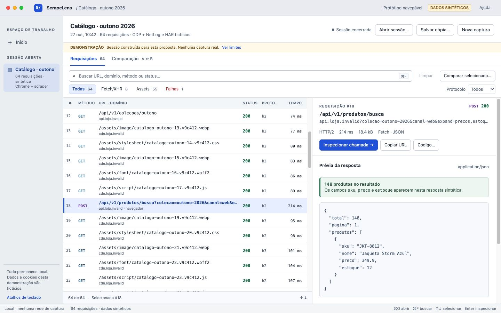
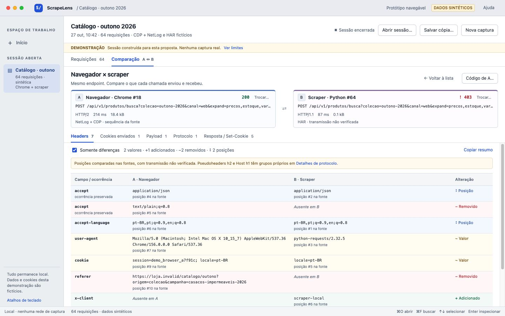

# ScrapeLens — UX review of the implementation

Date: 27/10/2026 · base inspected: `51e77aa` · recommended theme: light.

**Recommended direction:** an inspector with a persistent list, quick preview and detail in the same workspace. The source and the limit of the evidence stay close to the headers; comparison starts from the current selection and is organized by category.

The product already has strong foundations: virtualized table, visible search and filters, selectable technical values, header copy, arrays with duplicates, an identified normalized view, raw and parsed cookies kept separate, and errors that preserve the previous session. The proposal keeps these foundations. The main problems are interpretation of the evidence, discovery of APIs in an imported HAR, loss of context, and the absence of an export path in the interface.

## What was actually investigated

I read `CONTRIBUTING.md`, `docs/01-decisions.md`, `docs/03-contracts.md`, `docs/04-ownership.md`, the frontend and shell READMEs, the React implementation, styles, adapter v1, diff, the Tauri bridge, commands and the HAR importer.

I ran the existing frontend with `cd app && npm run dev -- --host 127.0.0.1`. I used the interface rendered in Brave with the embedded fixture of 13 calls and the stress fixture of 12,000 calls. The earlier captures from this work are in [before](before/README.md); I did not reuse old images as evidence of the current inspection.

I also opened the macOS application. The main window had an active recording during the investigation; I did not stop it. For the remaining native tests, I generated a build of the **same frontend and backend**, changing only the name, title and identifier through external configuration. The instance `app.scrapelens.uxreview` uses its own data folder. In it, I imported a synthetic HAR, reopened the automatically saved session and provoked an error with an invalid HAR.

**I did not test real capture in this work.** The protocols, cookies, bodies and events shown in the proposal are fictitious. The native import command was actually executed; the imported content was deliberately constructed, with no network traffic.

### Stack and organization found

| Part | Existing implementation | Consequence for the proposal |
|---|---|---|
| Frontend | React 19, TypeScript, Vite 7 | Reuse React components and state; no framework change |
| Navigation | `View` and `DetailTab` in `App.tsx`; URL parameters for demonstration; no dedicated router | Evolve the layout and selection without introducing new routing |
| Components | `HeaderBlock`, `BodyPanel`, `BodyContext`, `VerificationPanel`, `DetailView`, `CompareView` | Preserve data rendering and extract only the necessary panels |
| List | Virtualized table with fixed rows, overscan and `ResizeObserver` | Keep virtualization in production; the 64-item prototype does not replace it |
| Styles | Own CSS, tokens in `.app`, light/dark theme, system font and SF Mono | Feasible changes in CSS and existing tokens |
| Model | Contract v1 → `adaptSession` → `RequestRecord` | Present the evidence already available; do not invent certainty |
| Desktop | Tauri 2, menus/dialogs, clipboard, integrated Rust core | Preserve native integration and reuse existing commands |
| Export | cURL/Python in the core and CLI; no corresponding action in the UI/bridge | Exposing it requires Tauri integration, not a new exporter |

## Journey A–H

| Task | Observed result | Limit |
|---|---|---|
| A. Open without a session | A new instance opens the 13-call demonstration directly. I did not find a "no session" initial state | The proposal's empty entry is new UX |
| B. Start or import | Native import of `catalogo-synthetic.har`: 64 calls, zero warnings, folder saved | Real capture not started by the evaluation; NetLog not imported in this test |
| C. Find API | Search + Fetch/XHR work in the embedded demo. In the imported HAR, all calls become "other"; Fetch/XHR returns zero | The fixture contains `_resourceType`; the current importer does not carry it |
| D. Locate header/cookie | Headers have individual copy; Cookies separates sent, raw and Set-Cookie. There is no search inside the headers | Copying a header in the detail showed no confirmation there |
| E. Protocol and sequence | Protocol per call is in the list and in the detail. There is source and verification per item | "Verified", next to "source sequence", does not specify the object of the verification |
| F. Compare | Diff preserves multiplicity and distinguishes value/addition/removal/reordering by text | The global button opens the default pair #9/#10, ignoring the call in focus; the summary counts only sent headers |
| G. Copy/export | I triggered header copy. The action exists and the values are selectable | There is no code export in the current UI; exporters found in the core |
| H. Save/reopen | The import saves automatically. I reopened the native folder: 64 calls | There is no "Save as" in the UI; reopening a real capture was not tested |

## Prioritized diagnosis

P0 = prevents or induces error in the main task. P1 = frequent friction. P2 = useful refinement. The benefits below are **design expectations**, not measurements with users.

### P0 · 01 — The interface may suggest a certainty the source does not provide

**Observed problem:** the demo shows "source sequence" and "verified" for CDP headers. The full explanation sits in the side panel, alongside several different verifications. The imported synthetic HAR receives "REAL SESSION". The absence of the internal label `synthetic-fixture` is used as the counterpoint to "real"; this does not authenticate an import. Evidence: [current detail](before/02-detail-1440.jpg), [fictitious HAR with real label](before/08-desktop-har-synthetic.png).

**Task impaired:** deciding whether the transmitted order was preserved and correctly trusting a browser × scraper comparison.

**Concrete change:** replace the collection of badges with one line per direction: "NetLog · source sequence. Transmission not verified (partial evidence)", with "Understand" and the full event on demand. Use "Imported HAR", "Local capture" and "Demonstration" as origin, separate from "ended/partial/recording" and from the HTTP status. Do not infer "transmission confirmed" solely from `verification === verified`. Solution: [detail](after/03-detail-1440.jpg), [explanation](after/07-evidence-1440.jpg).

**Expected benefit:** reduce incorrect conclusions about order, authenticity and fidelity.

**Cost/tradeoff:** requires a conservative, auditable presentation policy per protocol, direction and event. Some information that is green today will become "not verified". If the contract does not distinguish verification of values from that of sequence, leave the sequence unverified; a richer classification will require additional data/contract.

### P0 · 02 — The API filter hides APIs after the HAR import

**Observed problem:** in the 64-call HAR, all types are "other"; Fetch/XHR 0 produces an empty list, even though there are JSON calls and `_resourceType: fetch`. `core/src/parse/har.rs` does not fill in `resourceType`; the adapter falls back to `other`. Evidence: [import](before/08-desktop-har-synthetic.png), [empty filter](before/09-desktop-filter-api-empty.png).

**Task impaired:** finding the call that carries data among many assets.

**Concrete change:** in the UI, differentiate "type not provided" from "other" and explain the limitation when the filter returns zero for lack of types. Add an independent "JSON" filter, based on the MIME already available, without calling it Fetch. In the importer integration, preserve `_resourceType` when it exists; for a HAR without that extension, keep showing unknown type. The proposal demonstrates Fetch/XHR using a classification **explicitly provided by the fixture**, not a fix already delivered in the importer: [proposed filter](after/06-filter-api-1440.jpg).

**Expected benefit:** do not induce "there was no API"; offer a useful search even when the initiator type is absent.

**Cost/tradeoff:** JSON is an approximation by content, not proof of Fetch/XHR. Preserving `_resourceType` requires an adjustment in the Rust importer, listed separately in the plan; it was not implemented in this review.

### P1 · 03 — The first screen starts on the example, without a clear choice of work

**Observed problem:** opening an isolated installation loads the demo. Capture, open and import appear spread across two bars. The demo is well identified, but it takes the place of the entry. Evidence: [current start](before/01-start-demo-1440.jpg).

**Task impaired:** starting a capture or resuming earlier work.

**Concrete change:** a "No session open" state with start capture, choose file, open session folder and optional demonstration. Name HAR/NetLog in full in the initial flow; distinguish importing a file from opening a v1 bundle. Solution: [entry](after/01-entry-1440.jpg).

**Expected benefit:** make the next action evident and reduce the need to interpret the example session.

**Cost/tradeoff:** adds an application state, which must remain accessible without discarding the open session. The prototype's capture is an explicit simulation.

### P1 · 04 — Inspecting removes the context of the list

**Observed problem:** clicking a row swaps the entire screen. To investigate the neighbor, go back and choose another. ⌘F in the detail also takes you back to the session. Evidence: [list](before/01-start-demo-1440.jpg), [detail without list](before/02-detail-1440.jpg).

**Task impaired:** going through candidates, checking cookies in similar calls and returning to the comparison.

**Concrete change:** a simple selection updates a preview; Enter or "Inspect call" opens the detail on the right. Keep list, filters, selection, scroll position and tabs. During inspection, move the search to the list column and narrow its secondary columns. Solutions: [session](after/02-session-1440.jpg), [detail](after/03-detail-1440.jpg).

**Expected benefit:** reduce screen switches and preserve the investigation's reference.

**Cost/tradeoff:** the detail loses width; URLs in the list become abbreviated. The detail header keeps the full URL selectable, with line wrapping and copy; time/protocol remain in the detail. Do not require reading through a tooltip.

### P1 · 05 — Clickable rows have no equivalent keyboard operation

**Observed problem:** rows are `<tr onClick>` without `tabIndex`/arrow/Enter handling. The tabs use `role=tab`, but do not implement arrow navigation. ⌘F exists and is useful; this does not allow reaching the detail without a mouse.

**Task impaired:** going through many calls and keeping a keyboard workflow.

**Concrete change:** one Tab stop in the list, visible focus, ↑/↓ for selection, Enter for detail, Escape for preview; tabs with roving focus and ←/→; ⌘C reserved for selected text and ⌘⇧C for URL. The virtualized selection must scroll to the item, without creating thousands of Tab stops. The proposal tests arrows, Enter and tabs; it does not reimplement the production virtualization.

**Expected benefit:** enable sequential inspection and use without switching to the mouse.

**Cost/tradeoff:** keep selection and focus as related but distinct states; test limits, filter and row removal. Do not take editing shortcuts in inputs.

### P1 · 06 — The comparison takes a while to reach the relevant differences

**Observed problem:** the global button opens two default selections, not the current call; the selects display long URLs. All equal rows take up height before cookies and bodies. "7 differences" in the demo counts only sent headers; there are differences in the response and cookies outside this total. The comparison does not bring the limit of the evidence next to the indices. Evidence: [current comparison](before/04-comparison-1440.jpg).

**Task impaired:** comparing browser with scraper, especially two nearly identical requests.

**Concrete change:** "Compare selected" fills in A; choose B by search in the session list. Pin A/B, method, endpoint, status and protocol in the header. Tabs Headers, Sent cookies, Payload, Protocol and Response/Set-Cookie with their own counts. "Differences only" by default; text and symbols for addition, removal, value and position. Original indices, repeated occurrences and the clarification "positions in the sources" when necessary. Raw as a complementary action. Solution: [comparison](after/04-comparison-1440.jpg).

**Expected benefit:** locate the useful difference without going through equal pairs; avoid an incomplete total and a conclusion about wire order.

**Cost/tradeoff:** differences become distributed across categories, with one view at a time. Header and counts compensate for this; keep access to the equal ones. The prototype's choice of B uses a select for 64 records; the production implementation must use search for 12 thousand items. Comparison between sessions is not ready.

### P1 · 07 — Small technical hierarchy and advanced details competing with the data

**Observed problem:** the detail reserves a permanent column for source, correlation and eight verifications, in all tabs. Many values/metadata use 9.5–11 px. The frame, outer padding and HTML window bar add to the native macOS window. Evidence: [detail](before/02-detail-1440.jpg), [desktop](before/08-desktop-har-synthetic.png), [notebook](before/06-session-1280.jpg).

**Task impaired:** reading long values on a laptop and concentrating on the header being sought.

**Concrete change:** fill the usable area, use a 13 px system font in controls and 11–12 px mono for data depending on the column; raise priority values to 12 px. Remove the frame/shadow and simulated window controls on desktop. Short contextual evidence next to the table, event/correlation details in Evidence. Local search by name/value. Collapsible pseudoheaders with count and explicit indices; normalization remains opt-in and labeled. Solutions: [detail](after/03-detail-1440.jpg), [1280 × 800](after/03-detail-1280.jpg).

**Expected benefit:** more width for values and less effort to find a header.

**Cost/tradeoff:** full events and pseudoheaders require expansion. Do not hide serious warnings/relevant ambiguity of the call; the advanced panel must preserve the current data. The window bar in the web prototype is an illustration of the shell, not a second set to implement in Tauri.

### P1 · 08 — Copy works without confirmation at the place of the action

**Observed problem:** copy buttons exist in `HeaderBlock`; the message is written to `notice`, but the notice is rendered only in the session view. When copying in the detail, no visible confirmation appeared. Parsed cookies have no equivalent per-pair copy action. Evidence: [headers](before/02-detail-1440.jpg), [cookies](before/03-cookies-1440.jpg).

**Task impaired:** transferring an exact value to the scraper without repeating clicks or manually selecting long text.

**Concrete change:** a global copy status, short and accessible via `role=status`, without moving the table; buttons identified on focus/hover and copy of the full value. In cookies, allow copying pair, value or raw field; do not concatenate Set-Cookie. Solutions: [cookies](after/05-cookies-1440.jpg), interactive prototype.

**Expected benefit:** confirm the action and reduce partial-selection errors.

**Cost/tradeoff:** more controls per table; use accessible labels per occurrence and keep text selectable. The confirmation expires; a clipboard failure must offer manual selection.

### P1 · 09 — The flow ends before the transformation into code

**Observed problem:** I did not find export cURL/Python in the interface nor an export command in the bridge. The exporters exist in `core/src/export/`.

**Task impaired:** taking an investigated call to a reproduction outside the browser.

**Concrete change:** a "Code…" button in the detail and in the A reference, opening a preview and an explanation of the limitations before copying/saving. Connect to the existing exporters and their warnings about bodies, pseudoheaders and protocol. Do not promise wire preservation by presenting an ordered list of headers in the script. Solution: [code preview](after/08-code-1440.jpg).

**Expected benefit:** complete the path from inspection to reproduction.

**Cost/tradeoff:** needs new Tauri commands/bridge over existing functions; it is not just CSS. The prototype generates only a local cURL example from the fixture and identifies this limitation. Python in the product must use the current exporter, without a parallel conversion in the frontend.

### P2 · 10 — Existing persistence is poorly explained; errors could better guide recovery

**Observed problem:** the import saves automatically and reopens through a folder dialog. The path appears as long text in the banner. There is no "Save as". The invalid HAR shows the reason and keeps the session, which must be preserved. Evidence: [reopening](before/10-desktop-session-reopened.png), [error](before/11-desktop-error-import.png).

**Task impaired:** knowing whether the work is saved and repeating an import that failed.

**Concrete change:** "Saved locally" and "Show in Finder" near the session context, using the existing `reveal_path`; separate import error from HTTP failure in the list. "Try another file" in the error. If there is a "Save copy", explain that it copies bundle and attachments, with clear scope and destination. In the prototype the button downloads demonstration JSON, expressly different from v1.

**Expected benefit:** reduce doubt about data loss and make recovery direct.

**Cost/tradeoff:** "Show in Finder" is an existing integration; a full "Save as" requires a bundle copy operation and a destination dialog, not yet implemented. None of these absences should block the inspection improvement.

## Fidelity: rules of the chosen direction

The presentation has two axes, not four simultaneous badges:

| Situation | Text next to the data | Detail on demand |
|---|---|---|
| Array available, order recorded | "Source sequence" | Source, event, direction and indices |
| Transmission order explicitly proven in the supported scope | "Transmission confirmed" | Evidence, browser version, protocol, method and limits |
| Fields available, proof absent/partial | "Transmission not verified" | What is available and what is missing; partial remains unconfirmed |
| Field/sequence not provided | "Sequence unavailable" | Reason; do not confuse with a legitimately absent header |
| Derived view | "Normalized · alphabetical" | Grouping, multiplicity, source indices; never "original" |

The meaning of `verified` needs to be audited before generating the second line. The repository's own material distinguishes limitations of CDP and of h2/h3 requests. The proposal does not declare any transmission confirmed: all the examples are synthetic.

Preserve in production: repeated pairs; pseudoheader group; original Cookie, parsed pairs and transmitted lines when they exist; independent Set-Cookie with attributes and parse error; sent versus received versus stored cookies; protocol per call; h3 announcement in Alt-Svc separate from observed use. The proposal keeps the first two types of cookies and explains that a snapshot of stored ones and wire lines are unavailable in the fixture.

## Visual proposal and executable journey

Open [the prototype](http://127.0.0.1:4174/?view=entry) with the local server active. [Full instructions](proposal/README.md).

The fictitious session has 64 records: 55 assets, one document and eight Fetch calls. #18 and #64 use the same endpoint; A sends `session` and page 1; B omits `session`, uses page 2 and returns 403. There is a repeated Accept, two independent Set-Cookie, long values/URLs, h1/h2/h3 assigned by the fixture and an Alt-Svc announcement without promoting it to the call's protocol.

The 403 error **is not causally attributed** to the cookie, protocol or differing header: the comparison describes differences, without diagnosing a blocking mechanism.

## Verification and limits

- The four final views were captured and examined at **1440 × 900 and 1280 × 800**. The document does not exceed the viewport; list/detail/diff regions have their own scrolling. Long data wraps in the detail and is abbreviated in the list, with the full URL available. I fixed out-of-view selection, sticky header, broken time unit and usable height after opening the images.
- Validated in the prototype: API filter, URL search, arrows/Enter in the list, tabs with arrows, header search keeping occurrence/index, exact copy of `text/plain;q=0.8`, evidence explanation, labeled normalization, comparison categories, A/B inversion and cURL copy.
- The JSON download occurred and the file was compared to the fixture: 64 identical records. The download event and the upload selector of the browser automation timed out; therefore **reopening that JSON in the prototype was not validated end to end**. Reopening a v1 session in the native application was validated separately.
- There was no user study, full VoiceOver, text zoom, real capture, Intel test or benchmark of the proposal with 12 thousand records. The existing virtualization must be preserved.
- A native import error was observed. Long loading and real recording states were not exercised; their evaluation derives from the code. The prototype's capture simulation is not evidence of the capturer.
- No production file was edited. The isolated build generated ignored files in `app/dist`/`src-tauri/target`; the new artifacts stay in this folder. Native test sessions are under the isolated identifier.

## Supporting references

The recommendation of keyboard commands and focus follows the [Apple HIG — Keyboards](https://developer.apple.com/design/human-interface-guidelines/keyboards/). Search by properties, request list and filters by type are documented patterns in the [Chrome DevTools — Network reference](https://developer.chrome.com/docs/devtools/network/reference). These references support interaction familiarity; the problems listed above come from the execution and the code of ScrapeLens, not from an abstract comparison with competitors.

The principle of hierarchy by task from the `revenue-centric-design` skill ("remove information to guide action") was applied. No conversion, monetization or landing page techniques were applied to this technical tool.
