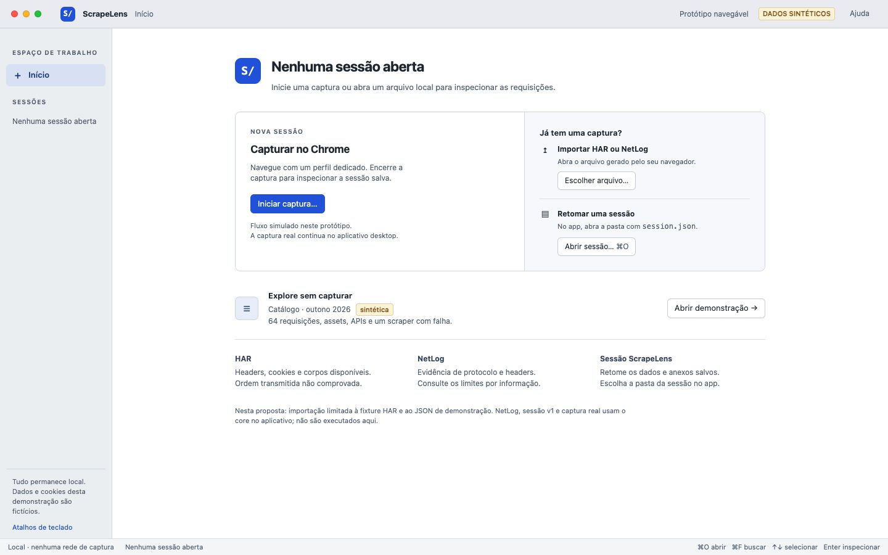
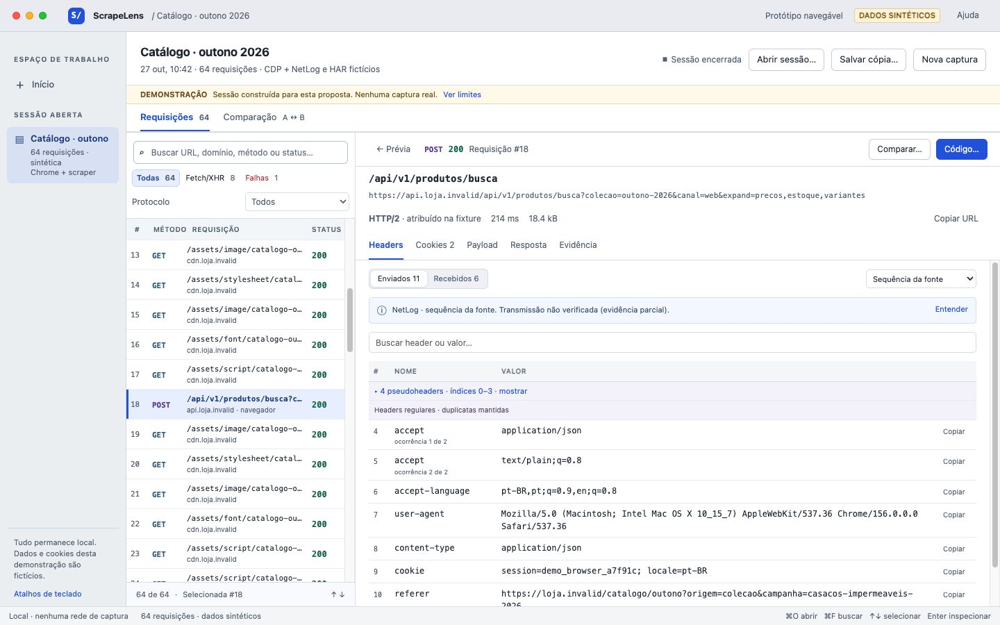

# ScrapeLens — revisão de UX da implementação

Data: 27/10/2026 · base inspecionada: `51e77aa` · tema recomendado: claro.

**Direção recomendada:** um inspetor com lista persistente, prévia rápida e detalhe no mesmo espaço de trabalho. A fonte e o limite da evidência ficam próximos dos headers; a comparação começa pela seleção atual e se organiza por categoria.

O produto já tem fundamentos fortes: tabela virtualizada, busca e filtros visíveis, valores técnicos selecionáveis, cópia de headers, arrays com duplicatas, visão normalizada identificada, cookies brutos e parseados separados e erros que preservam a sessão anterior. A proposta mantém esses fundamentos. Os principais problemas são interpretação da evidência, descoberta de APIs em HAR importado, perda de contexto e a ausência de um caminho de exportação na interface.

## O que foi realmente investigado

Li `CONTRIBUTING.md`, `docs/01-decisoes.md`, `docs/03-contratos.md`, `docs/04-propriedade.md`, os READMEs do frontend e shell, a implementação React, estilos, adaptador v1, diff, ponte Tauri, comandos e importador HAR.

Executei o frontend existente com `cd app && npm run dev -- --host 127.0.0.1`. Usei a interface renderizada no Brave com a fixture embutida de 13 chamadas e a fixture de estresse de 12.000 chamadas. As capturas anteriores deste trabalho estão em [before](before/README.md); não reutilizei imagens antigas como evidência da inspeção atual.

Abri também o aplicativo macOS. A janela principal passou a ter uma gravação ativa durante a investigação; não a interrompi. Para os testes nativos restantes, gerei um build do **mesmo frontend e backend**, alterando somente nome, título e identificador por configuração externa. A instância `app.scrapelens.uxreview` usa uma pasta de dados própria. Nela, importei um HAR sintético, reabri a sessão salva automaticamente e provoquei erro com um HAR inválido.

**Não testei captura real neste trabalho.** Os protocolos, cookies, corpos e eventos exibidos na proposta são fictícios. O comando nativo de importação foi executado de fato; o conteúdo importado foi deliberadamente construído, sem tráfego de rede.

### Stack e organização encontradas

| Parte | Implementação existente | Consequência para a proposta |
|---|---|---|
| Frontend | React 19, TypeScript, Vite 7 | Reutilizar componentes e estado React; nenhuma troca de framework |
| Navegação | `View` e `DetailTab` em `App.tsx`; parâmetros de URL para demonstração; sem roteador dedicado | Evoluir o layout e a seleção sem introduzir roteamento novo |
| Componentes | `HeaderBlock`, `BodyPanel`, `BodyContext`, `VerificationPanel`, `DetailView`, `CompareView` | Preservar renderização de dados e extrair apenas os painéis necessários |
| Lista | Tabela virtualizada de linhas fixas, overscan e `ResizeObserver` | Manter virtualização em produção; o protótipo de 64 itens não a substitui |
| Estilos | CSS próprio, tokens em `.app`, tema claro/escuro, fonte do sistema e SF Mono | Mudanças viáveis em CSS e tokens existentes |
| Modelo | Contrato v1 → `adaptSession` → `RequestRecord` | Apresentar a evidência já disponível; não inventar certeza |
| Desktop | Tauri 2, menus/diálogos, clipboard, core Rust integrado | Preservar integração nativa e reaproveitar comandos existentes |
| Exportação | cURL/Python no core e CLI; sem ação correspondente na UI/ponte | Expor exige integração Tauri, não um novo exportador |

## Percurso A–H

| Tarefa | Resultado observado | Limite |
|---|---|---|
| A. Abrir sem sessão | Uma instância nova abre diretamente a demonstração de 13 chamadas. Não encontrei estado inicial “sem sessão” | A entrada vazia da proposta é nova UX |
| B. Iniciar ou importar | Importação nativa de `catalogo-sintetico.har`: 64 chamadas, zero avisos, pasta salva | Captura real não iniciada pela avaliação; NetLog não importado neste teste |
| C. Encontrar API | Busca + Fetch/XHR funcionam na demo embutida. No HAR importado, todas as chamadas viram “outro”; Fetch/XHR retorna zero | A fixture contém `_resourceType`; o importador atual não o transporta |
| D. Localizar header/cookie | Headers possuem cópia individual; Cookies separa enviados, bruto e Set-Cookie. Não há busca dentro dos headers | Copiar header no detalhe não mostrou confirmação ali |
| E. Protocolo e sequência | Protocolo por chamada está na lista e no detalhe. Há fonte e verificação por informação | “Verificada”, ao lado de “sequência da fonte”, não especifica o objeto da verificação |
| F. Comparar | Diff preserva multiplicidade e distingue valor/adição/remoção/reordenação por texto | O botão global abre o par padrão #9/#10, ignorando a chamada em foco; resumo conta só headers enviados |
| G. Copiar/exportar | Acionei cópia de header. A ação existe e os valores são selecionáveis | Não há exportação de código na UI atual; exportadores encontrados no core |
| H. Salvar/reabrir | A importação salva automaticamente. Reabri a pasta nativa: 64 chamadas | Não há “Salvar como” na UI; não foi testada reabertura de uma captura real |

## Diagnóstico priorizado

P0 = impede ou induz erro na tarefa principal. P1 = atrito frequente. P2 = refinamento útil. Os benefícios abaixo são **expectativas de design**, não medições com usuários.

### P0 · 01 — A interface pode sugerir uma certeza que a fonte não fornece

**Problema observado:** a demo mostra “sequência da fonte” e “verificada” para headers CDP. A explicação completa fica no painel lateral, junto de várias verificações diferentes. O HAR sintético importado recebe “SESSÃO REAL”. A ausência da label interna `synthetic-fixture` é usada como contraponto a “real”; isso não autentica uma importação. Evidências: [detalhe atual](before/02-detalhe-1440.jpg), [HAR fictício com rótulo real](before/08-desktop-har-sintetico.png).

**Tarefa prejudicada:** decidir se a ordem transmitida foi preservada e confiar corretamente numa comparação navegador × scraper.

**Alteração concreta:** substituir a coleção de badges por uma linha por direção: “NetLog · sequência da fonte. Transmissão não verificada (evidência parcial)”, com “Entender” e o evento completo sob demanda. Usar “HAR importado”, “Captura local” e “Demonstração” como origem, separadas de “encerrada/parcial/gravando” e do status HTTP. Não inferir “transmissão confirmada” somente de `verification === verified`. Solução: [detalhe](after/03-detalhe-1440.jpg), [explicação](after/07-evidencia-1440.jpg).

**Benefício esperado:** reduzir conclusões incorretas sobre ordem, autenticidade e fidelidade.

**Custo/tradeoff:** exige uma política de apresentação conservadora e auditável por protocolo, direção e evento. Algumas informações hoje verdes passarão a “não verificadas”. Se o contrato não distinguir verificação de valores e de sequência, deixar a sequência não verificada; uma classificação mais rica exigirá dados/contrato adicionais.

### P0 · 02 — O filtro de APIs esconde APIs após a importação HAR

**Problema observado:** no HAR de 64 chamadas, todos os tipos são “outro”; Fetch/XHR 0 produz lista vazia, apesar de existirem chamadas JSON e `_resourceType: fetch`. `core/src/parse/har.rs` não preenche `resourceType`; o adaptador cai em `other`. Evidências: [importação](before/08-desktop-har-sintetico.png), [filtro vazio](before/09-desktop-filtro-api-vazio.png).

**Tarefa prejudicada:** encontrar a chamada que traz dados entre muitos assets.

**Alteração concreta:** na UI, diferenciar “tipo não informado” de “outro” e explicar a limitação quando o filtro zera por falta de tipos. Acrescentar um filtro independente “JSON”, baseado no MIME já disponível, sem chamá-lo de Fetch. Na integração do importador, preservar `_resourceType` quando existir; para HAR sem essa extensão, continuar mostrando tipo desconhecido. A proposta demonstra Fetch/XHR usando classificação **explicitamente fornecida pela fixture**, não uma correção já entregue no importador: [filtro proposto](after/06-filtro-api-1440.jpg).

**Benefício esperado:** não induzir “não houve API”; oferecer uma busca útil mesmo quando o tipo de iniciador estiver ausente.

**Custo/tradeoff:** JSON é aproximação por conteúdo, não prova de Fetch/XHR. Preservar `_resourceType` exige ajuste no importador Rust, listado separadamente no plano; não foi implementado nesta revisão.

### P1 · 03 — A primeira tela começa no exemplo, sem uma escolha de trabalho clara

**Problema observado:** abrir uma instalação isolada carrega a demo. Capturar, abrir e importar aparecem distribuídos em duas barras. A demo é bem identificada, mas ocupa o lugar da entrada. Evidência: [início atual](before/01-inicio-demo-1440.jpg).

**Tarefa prejudicada:** começar uma captura ou retomar trabalho anterior.

**Alteração concreta:** estado “Nenhuma sessão aberta” com iniciar captura, escolher arquivo, abrir pasta de sessão e demonstração opcional. Nomear HAR/NetLog por extenso no fluxo inicial; distinguir importar arquivo de abrir bundle v1. Solução: [entrada](after/01-entrada-1440.jpg).

**Benefício esperado:** tornar a próxima ação evidente e reduzir a necessidade de interpretar a sessão de exemplo.

**Custo/tradeoff:** acrescenta um estado de aplicação, que deve continuar acessível sem descartar a sessão aberta. A captura do protótipo é simulação explícita.

### P1 · 04 — Inspecionar remove o contexto da lista

**Problema observado:** clicar numa linha troca a tela inteira. Para investigar a vizinha, voltar e escolher outra. ⌘F no detalhe também leva de volta à sessão. Evidências: [lista](before/01-inicio-demo-1440.jpg), [detalhe sem lista](before/02-detalhe-1440.jpg).

**Tarefa prejudicada:** percorrer candidatas, conferir cookies em chamadas semelhantes e voltar à comparação.

**Alteração concreta:** seleção simples atualiza uma prévia; Enter ou “Inspecionar chamada” abre o detalhe à direita. Manter lista, filtros, seleção, posição de rolagem e abas. Na inspeção, mover a busca para a coluna da lista e estreitar suas colunas secundárias. Soluções: [sessão](after/02-sessao-1440.jpg), [detalhe](after/03-detalhe-1440.jpg).

**Benefício esperado:** reduzir alternâncias de tela e preservar a referência da investigação.

**Custo/tradeoff:** o detalhe perde largura; URLs na lista ficam abreviadas. O cabeçalho do detalhe mantém URL completa selecionável, quebra de linha e cópia; tempo/protocolo continuam no detalhe. Não exigir leitura por tooltip.

### P1 · 05 — Linhas clicáveis não têm uma operação equivalente por teclado

**Problema observado:** linhas são `<tr onClick>` sem `tabIndex`/tratamento de setas/Enter. As abas usam `role=tab`, mas não implementam navegação por setas. ⌘F existe e é útil; isso não permite chegar ao detalhe sem mouse.

**Tarefa prejudicada:** percorrer muitas chamadas e manter fluxo de trabalho por teclado.

**Alteração concreta:** um ponto de Tab na lista, foco visível, ↑/↓ para seleção, Enter para detalhe, Escape para prévia; abas com foco móvel e ←/→; ⌘C reservado a texto selecionado e ⌘⇧C para URL. A seleção virtualizada deve rolar até o item, sem criar milhares de pontos de Tab. A proposta testa setas, Enter e abas; não reimplementa a virtualização de produção.

**Benefício esperado:** viabilizar inspeção sequencial e uso sem alternância para o mouse.

**Custo/tradeoff:** manter seleção e foco como estados relacionados, mas distintos; testar limites, filtro e remoção de linhas. Não tomar atalhos de edição em inputs.

### P1 · 06 — A comparação demora a chegar às diferenças relevantes

**Problema observado:** o botão global abre duas seleções padrão, não a chamada atual; os selects exibem URLs longas. Todas as linhas iguais ocupam altura antes de cookies e corpos. “7 diferenças” na demo contabiliza apenas headers enviados; há diferenças em resposta e cookies fora desse total. A comparação não traz o limite da evidência junto dos índices. Evidência: [comparação atual](before/04-comparacao-1440.jpg).

**Tarefa prejudicada:** comparar navegador com scraper, especialmente duas requisições quase iguais.

**Alteração concreta:** “Comparar selecionada” preenche A; escolher B por busca na lista da sessão. Fixar A/B, método, endpoint, status e protocolo no cabeçalho. Abas Headers, Cookies enviados, Payload, Protocolo e Resposta/Set-Cookie com contagens próprias. “Somente diferenças” por padrão; texto e símbolos para adição, remoção, valor e posição. Índices originais, ocorrências repetidas e esclarecimento “posições nas fontes” quando necessário. Bruto como ação complementar. Solução: [comparação](after/04-comparacao-1440.jpg).

**Benefício esperado:** localizar a diferença útil sem percorrer pares iguais; evitar total incompleto e conclusão sobre ordem no fio.

**Custo/tradeoff:** diferenças passam a ser distribuídas em categorias, com uma visão por vez. Cabeçalho e contagens compensam isso; manter consulta aos iguais. A escolha de B do protótipo usa select para 64 registros; a implementação de produção deve usar busca para 12 mil itens. Comparação entre sessões não está pronta.

### P1 · 07 — Hierarquia técnica pequena e detalhes avançados competindo com o dado

**Problema observado:** o detalhe reserva uma coluna permanente para fonte, correlação e oito verificações, em todas as abas. Muitos valores/metadados usam 9,5–11 px. A moldura, padding externo e barra HTML de janela se somam à janela macOS nativa. Evidências: [detalhe](before/02-detalhe-1440.jpg), [desktop](before/08-desktop-har-sintetico.png), [notebook](before/06-sessao-1280.jpg).

**Tarefa prejudicada:** ler valores extensos em notebook e concentrar-se no header procurado.

**Alteração concreta:** preencher a área útil, usar fonte do sistema de 13 px nos controles e mono de 11–12 px nos dados conforme a coluna; elevar valores prioritários a 12 px. Remover moldura/sombra e controles de janela simulados no desktop. Evidência contextual curta junto da tabela, detalhes de evento/correlação em Evidência. Busca local por nome/valor. Pseudoheaders recolhíveis com contagem e índices explícitos; normalização continua opt-in e rotulada. Soluções: [detalhe](after/03-detalhe-1440.jpg), [1280 × 800](after/03-detalhe-1280.jpg).

**Benefício esperado:** mais largura para valores e menos esforço para encontrar um header.

**Custo/tradeoff:** eventos completos e pseudoheaders exigem expansão. Não ocultar avisos graves/ambiguidade relevante da chamada; o painel avançado deve preservar os dados atuais. A barra de janela no protótipo web é ilustração do shell, não um segundo conjunto a implementar em Tauri.

### P1 · 08 — A cópia funciona sem confirmação no local da ação

**Problema observado:** botões de cópia existem em `HeaderBlock`; a mensagem é gravada em `notice`, mas o aviso é renderizado apenas na vista de sessão. Ao copiar no detalhe, não apareceu confirmação visível. Cookies parseados não têm ação equivalente de cópia por par. Evidências: [headers](before/02-detalhe-1440.jpg), [cookies](before/03-cookies-1440.jpg).

**Tarefa prejudicada:** transferir um valor exato ao scraper sem repetir cliques ou selecionar texto longo manualmente.

**Alteração concreta:** status de cópia global, curto e acessível via `role=status`, sem mover a tabela; botões identificados em foco/hover e cópia do valor completo. Em cookies, permitir copiar par, valor ou campo bruto; não concatenar Set-Cookie. Soluções: [cookies](after/05-cookies-1440.jpg), protótipo interativo.

**Benefício esperado:** confirmar a ação e reduzir erro de seleção parcial.

**Custo/tradeoff:** mais controles por tabela; usar rótulos acessíveis por ocorrência e manter texto selecionável. A confirmação expira; falha de clipboard precisa oferecer seleção manual.

### P1 · 09 — O fluxo termina antes da transformação em código

**Problema observado:** não encontrei exportar cURL/Python na interface nem command de exportação na ponte. Os exportadores existem em `core/src/export/`.

**Tarefa prejudicada:** levar uma chamada investigada para uma reprodução fora do navegador.

**Alteração concreta:** botão “Código…” no detalhe e na referência A, abrindo prévia e explicação das limitações antes de copiar/salvar. Ligar aos exportadores existentes e seus avisos sobre corpos, pseudoheaders e protocolo. Não prometer preservação no fio por apresentar uma lista ordenada de headers no script. Solução: [prévia de código](after/08-codigo-1440.jpg).

**Benefício esperado:** completar o percurso de inspeção para reprodução.

**Custo/tradeoff:** necessita novos commands/ponte Tauri sobre funções existentes; não é apenas CSS. O protótipo gera somente um exemplo cURL local da fixture e identifica essa limitação. Python no produto deve usar o exportador atual, sem conversão paralela no frontend.

### P2 · 10 — Persistência existente é pouco explicada; erros podem orientar melhor a recuperação

**Problema observado:** a importação salva automaticamente e reabre por diálogo de pasta. O caminho aparece como texto extenso no banner. Não há “Salvar como”. O HAR inválido mostra motivo e mantém a sessão, o que deve ser preservado. Evidências: [reabertura](before/10-desktop-sessao-reaberta.png), [erro](before/11-desktop-erro-importacao.png).

**Tarefa prejudicada:** saber se o trabalho está salvo e repetir uma importação que falhou.

**Alteração concreta:** “Salva localmente” e “Mostrar no Finder” próximos do contexto da sessão, usando `reveal_path` existente; separar erro de importação de falha HTTP na lista. “Tentar outro arquivo” no erro. Se houver “Salvar cópia”, explicar que copia bundle e anexos, com escopo e destino claros. No protótipo o botão baixa JSON de demonstração, expressamente diferente do v1.

**Benefício esperado:** reduzir dúvida sobre perda de dados e tornar a recuperação direta.

**Custo/tradeoff:** “Mostrar no Finder” é integração existente; “Salvar como” completo exige operação de cópia do bundle e diálogo de destino, ainda não implementada. Nenhuma dessas ausências deve impedir a melhoria da inspeção.

## Fidelidade: regras da direção escolhida

A apresentação tem dois eixos, não quatro badges simultâneos:

| Situação | Texto junto do dado | Detalhe sob demanda |
|---|---|---|
| Array disponível, ordem registrada | “Sequência da fonte” | Fonte, evento, direção e índices |
| Ordem de transmissão explicitamente comprovada no escopo suportado | “Transmissão confirmada” | Evidência, versão do navegador, protocolo, método e limites |
| Campos disponíveis, comprovação ausente/parcial | “Transmissão não verificada” | O que está disponível e o que falta; parcial continua não confirmada |
| Campo/sequência não fornecido | “Sequência indisponível” | Motivo; não confundir com header legitimamente ausente |
| Visão derivada | “Normalizada · alfabética” | Agrupamento, multiplicidade, índices de origem; nunca “original” |

O significado de `verified` precisa ser auditado antes de gerar a segunda linha. O próprio material do repositório distingue limitações de CDP e de request h2/h3. A proposta não declara nenhuma transmissão confirmada: todos os exemplos são sintéticos.

Preservar em produção: pares repetidos; grupo de pseudoheaders; Cookie original, pares parseados e linhas transmitidas quando houver; Set-Cookie independentes com atributos e erro de parse; cookies enviados versus recebidos versus armazenados; protocolo por chamada; anúncio de h3 em Alt-Svc separado do uso observado. A proposta mantém os dois primeiros tipos de cookies e explica que snapshot de armazenados e linhas do fio estão indisponíveis na fixture.

## Proposta visual e percurso executável

Abra [o protótipo](http://127.0.0.1:4174/?view=entry) com o servidor local ativo. [Instruções completas](proposal/README.md).

A sessão fictícia tem 64 registros: 55 assets, um documento e oito chamadas Fetch. #18 e #64 usam o mesmo endpoint; A envia `session` e página 1; B omite `session`, usa página 2 e retorna 403. Há Accept repetido, dois Set-Cookie independentes, valores/URLs extensos, h1/h2/h3 atribuídos pela fixture e anúncio Alt-Svc sem promovê-lo a protocolo da chamada.

O erro 403 **não é atribuído causalmente** ao cookie, protocolo ou header diferente: a comparação descreve diferenças, sem diagnosticar um mecanismo de bloqueio.

## Verificação e limites

- As quatro vistas finais foram capturadas e examinadas em **1440 × 900 e 1280 × 800**. Documento não excede o viewport; regiões de lista/detalhe/diff têm rolagem própria. Dados longos quebram linha no detalhe e são abreviados na lista, com URL completa disponível. Corrigi seleção fora de vista, cabeçalho sticky, unidade de tempo quebrada e altura útil após abrir as imagens.
- Validados no protótipo: filtro de APIs, busca por URL, setas/Enter na lista, abas com setas, busca de header mantendo ocorrência/índice, cópia exata de `text/plain;q=0.8`, explicação de evidência, normalização rotulada, categorias de comparação, inversão A/B e cópia cURL.
- O download de JSON ocorreu e o arquivo foi comparado à fixture: 64 registros idênticos. O evento de download e o seletor de upload da automação do navegador deram timeout; portanto **a reabertura desse JSON pelo protótipo não foi validada de ponta a ponta**. A reabertura de sessão v1 pelo aplicativo nativo foi validada separadamente.
- Não houve estudo com usuários, VoiceOver completo, zoom de texto, captura real, teste de Intel ou benchmark da proposta com 12 mil registros. A virtualização existente deve ser preservada.
- Erro de importação nativo foi observado. Estados longos de carregamento e gravação real não foram exercitados; sua avaliação deriva do código. A simulação de captura do protótipo não é evidência do capturador.
- Nenhum arquivo de produção foi editado. O build isolado gerou arquivos ignorados em `app/dist`/`src-tauri/target`; os artefatos novos ficam nesta pasta. Sessões nativas de teste estão no identificador isolado.

## Referências de apoio

A recomendação de comandos e foco por teclado acompanha as [Apple HIG — Keyboards](https://developer.apple.com/design/human-interface-guidelines/keyboards/). Busca por propriedades, lista de requisições e filtros por tipo são padrões documentados no [Chrome DevTools — Network reference](https://developer.chrome.com/docs/devtools/network/reference). Essas referências apoiam familiaridade de interação; os problemas listados acima vêm da execução e do código do ScrapeLens, não de uma comparação abstrata com concorrentes.

Foi aplicado o princípio de hierarquia por tarefa da skill `revenue-centric-design` (“remover informação para orientar a ação”). Não foram aplicadas técnicas de conversão, monetização ou landing page a esta ferramenta técnica.
